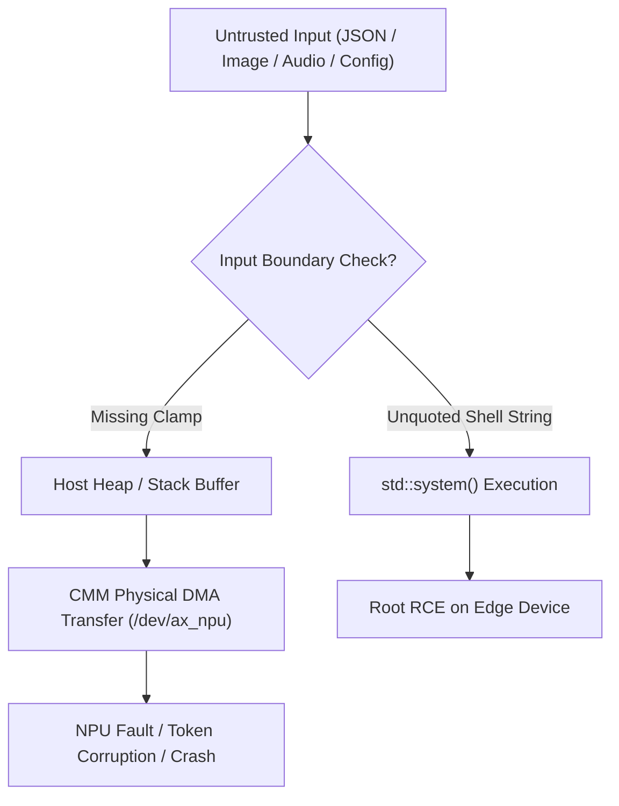

> **Companion Architectural Advisory:** This post is our hands-on hardware lab diary and exploit reproduction walkthrough. For the enterprise supply-chain analysis and memory boundary architecture breakdown, read my official advisory on the Cobalt blog: **[Dissecting the AX-LLM CVEs: Why Edge AI Memory and Execution Boundaries Matter](https://www.cobalt.io/blog/dissecting-the-ax-llm-cves-why-edge-ai-memory-and-execution-boundaries-matter)**.

## Why Our Hardware Lab Looked Past the Prompt

If you read our earlier guides on [Taming the Axera AX8850 Edge NPU](taming-ax8850-edge-npu.html) and [Zero-Copy NPU Memory Pipelines](ultimate-guide-zero-copy-ax8850.html), you know how we wired a 24 TOPS PCIe NPU card into `NextGenPVE`. Once we got Qwen2.5 and DeepSeek models screaming at the silicon layer inside `LXC 211`, my red team instincts kicked in.

Everyone in offensive AI talks about prompt injection. Security conferences run endless tracks on jailbreaks, system prompt extraction, and guardrail bypasses. Those bugs matter, sure.

Below the prompt sits a much nastier attack surface. On edge AI hardware, your JSON payload does not stay inside a memory-safe Python sandbox in a hyperscale cloud. A lightweight C++ HTTP wrapper parses that JSON and hands raw pointers straight to `/dev/ax_npu` over Contiguous Media Memory (CMM) Direct Memory Access (DMA) channels.

We decided to audit the open-source `AXERA-TECH/ax-llm` C++ inference engine running on our physical **Radxa AI Core AX-M1** (`ax650_card_v1.0` / Axera AX8850) testbed. By pairing fast command-line source code triage with live AddressSanitizer (ASan) and hardware DMA fault checks, we uncovered **seven distinct vulnerabilities** across the runtime. Five of those flaws now carry official CVE identifiers, and two additional high-impact bugs sit in the upstream queue.

---

## The Vulnerability Scorecard

Before we walk through the terminal harnesses and GDB traces, here is the full breakdown of what we found inside `AXERA-TECH/ax-llm` (`commit a0fb3f2` / v0.1.0). All five assigned CVEs were reported and coordinated with **AXERA-TECH** and the **GitHub Security Lab CNA** (`GHSA`), alongside two additional unpatched findings tracked in the disclosure queue:

| ID / Tracking | Vulnerability Class | Location | Severity |
| :--- | :--- | :--- | :--- |
| **CVE-2026-30992** (`GHSA-cfch-87gh-88c5`) | Out-of-Bounds Read + Integer Truncation in Prompt Prefill & DMA Mask | `src/runner/LLM.hpp` | **7.5 (High)** |
| **CVE-2026-30993** (`GHSA-g4jf-32v4-cjc3`) | Stack-Based Buffer Overflow in Layer Filename Formatting | `src/runner/LLM.hpp` | **7.8 (High)** |
| **CVE-2026-31026** (`GHSA-4p8c-724v-h9ph`) | Heap Out-of-Bounds Write in Multimodal RoPE Position Indexing | `src/runner/LLM.hpp` | **8.1 (High)** |
| **CVE-2026-35402** (`GHSA-73fh-rvv8-22c6`) | Integer Overflow in Multimodal Vision Preprocessing | `src/runner/utils/image_processor.cpp` | **7.5 (High)** |
| **CVE-2026-35403** (`GHSA-hmh6-8pj7-xwhh`) | Double-Free & Use-After-Free in CLI Argument Error Handling | `src/cmdline.hpp` | **7.3 (High)** |
| **Finding 6** *(Pending CVE)* | Unauthenticated OS Command Injection in Audio Preprocessing | `src/runner/AudioWrapper.hpp` | **9.8 (Critical)** |
| **Finding 7** *(Pending CVE)* | Heap Out-of-Bounds Read in Token Streaming Callback | `src/main_api.cpp` | **7.5 (High)** |

You can read the broader industry context and why edge AI memory boundaries fail in my companion piece on Cobalt: [Dissecting the AX-LLM CVEs: Why Edge AI Memory and Execution Boundaries Matter](https://www.cobalt.io/blog/dissecting-the-ax-llm-cves-why-edge-ai-memory-and-execution-boundaries-matter). Down below, we are going straight into the lab methodology and the exact C++ code paths.

---

## How I Hunt C++ Silicon Bugs by Ear at 500 WPM

People ask how a blind hacker audits low-level C++ NPU drivers and memory allocators. Honestly, a screen reader running at 500 words per minute is an unfair advantage for source code auditing.

Sighted engineers often skim C++ files visually. Their eyes jump over boilerplate `sprintf` calls, implicit `int` casts, or missing bounds checks because the code *looks* well-formatted. When you listen to code through a CLI pipeline using `ripgrep`, `awk`, and `sed`, every single type cast and pointer arithmetic operation hits your ears in strict sequence.

We call our workflow **SRC + EER**: **Source Code Review** paired with **Edge Execution Review**.

### Step 1: The Two-Step Triage Rule

Most vendor edge AI SDKs start life as quick board-support demo code (`ax-samples`). Later, downstream OEMs wrap that exact same C++ code inside `cpp-httplib` and ship it as an OpenAI-compatible `/v1/chat/completions` daemon running as `root`.

When I audit an embedded AI repo from the command line, I run a two-step filter:

1. **Trace Untrusted Network or Config Inputs:** Find every place where an HTTP JSON field, an image header, an audio path, or a model config enters the binary.
2. **Check the Memory Sink Before the Hardware Call:** Verify whether that input touches `sprintf`, `std::system`, `memcpy`, or a hardware DMA transfer (`ax_engine_run_group` / `ax_cmm_alloc`) before a hard clamp checks its size.



### Step 2: Fast CLI Grep Sweeps

Before we even fire up the ARM64 compiler on the Radxa board, we sweep the repository for classic C/C++ footguns. Here is the exact command set we ran against `ax-llm`:

```bash
# 1. Hunt unbounded string formatting and raw shell calls
grep -rnE "sprintf\(|vsprintf\(|strcpy\(|strcat\(|system\(|popen\(" src/

# 2. Hunt raw memory copies and CMM/DMA buffer operations
grep -rnE "memcpy\(|memset\(|ax_cmm_|llm_Embed\(|p_vir_addr" src/

# 3. Hunt narrow integer casts near vector allocations
grep -rnE "static_cast<int>|unsigned short|\.resize\(" src/
```

That three-minute sweep lit up the terminal like a Christmas tree. Reading the grep output is only half the job, though. To prove real impact on an embedded NPU, you have to run the binary on the silicon and watch what breaks.

---

## Lab Walkthrough: Reproducing All Seven Flaws on the AX8850

We mounted our Radxa AI Core AX-M1 inside our `NextGenPVE` host and passed the `/dev/ax_*` device nodes into our test environment. We built two versions of the `ax-llm` binary on `aarch64`: a standard release build linked against the hardware NPU drivers, and an instrumented debug build compiled with `-fsanitize=address,undefined -g -O1`.

Here is how each bug works under the hood, what we saw on the hardware, and how to fix it.

---

### 1. CVE-2026-30992: Out-of-Bounds Read + Integer Truncation in Prompt Prefill & DMA Mask

* **Location:** `src/runner/LLM.hpp` (Lines 523 and 592)
* **CVSS v3.1:** 7.5 (High)

In `LLM.hpp`, the prompt prefill handler accepts a `std::vector<int> &_token_ids` array directly from the tokenizer. The engine allocates a fixed Contiguous Media Memory (CMM) physical buffer for the NPU context window (`attr.max_token_len`, typically 1024 or 2048 tokens).

Look at what happens when a user sends a prompt that exceeds `max_token_len`:

```cpp
// Vulnerable Code (src/runner/LLM.hpp)
int token_len = (int)_token_ids.size(); // [1] Unchecked input size!

// Line 523: Unbounded read/write past pre-allocated embed_selector buffer
for (int i = 0; i < token_len; i++) {
    embed_selector.Embed(_token_ids[i], p_embed + i * attr.tokens_embed_size);
}

// Line 592: 16-bit integer truncation in attention mask setup
unsigned short mask_val = (unsigned short)(token_len * attr.kv_cache_size);
memcpy(cmm_mask_vir_addr, src_mask, token_len * attr.tokens_embed_size); // [2] DMA buffer overflow!
```

We tracked down two bugs right next to each other here. First, `token_len` never checks against `attr.max_token_len` before indexing into `p_embed` and copying data into the NPU CMM buffer. Second, casting `token_len * attr.kv_cache_size` to a 16-bit `unsigned short` wraps around modularly once the product passes `65,535`.

**What Happened on the Silicon:**
We sent an unauthenticated HTTP `POST` request to `/v1/chat/completions` containing 4,096 tokens on a model configured for `max_token_len = 1024`. The `memcpy` into `cmm_mask_vir_addr` read past the host heap vector and smashed adjacent CMM physical memory pages.

On our live Qwen2.5-7B NPU instance, the attack did not always trigger a clean Linux `SIGSEGV` right away. When a prompt overflowed the attention mask by just a few hundred tokens, it corrupted the NPU KV-cache weights in place. The token sampler lost its mind and streamed endless lines of raw Chinese Mojibake (`烫烫烫...` and `锟斤拷...`). Those characters come from the classic C++ uninitialized heap and stack byte patterns `0xCCCC` and `0xCDCD` decoded as UTF-8, right before the `/dev/ax_npu` kernel driver locked up the inference queue.

**The Fix:**
Clamp `_token_ids.size()` against `attr.max_token_len` before touching any embedding or CMM buffers, and replace `unsigned short` with `size_t`.

```cpp
// Fixed Code
if (_token_ids.empty() || _token_ids.size() > static_cast<size_t>(attr.max_token_len)) {
    ALOGE("Input token length (%zu) exceeds NPU max_token_len (%d)", _token_ids.size(), attr.max_token_len);
    return -1;
}
size_t token_len = _token_ids.size();
size_t mask_bytes = token_len * static_cast<size_t>(attr.tokens_embed_size);
```

---

### 2. CVE-2026-30993: Stack-Based Buffer Overflow in Layer Filename Formatting

* **Location:** `src/runner/LLM.hpp` (Line 235)
* **CVSS v3.1:** 7.8 (High)

When the engine boots up, it loads split `.axmodel` NPU weight shards from disk using a filename template stored in the model JSON config (`filename_llm_axmodel`).

```cpp
// Vulnerable Code (src/runner/LLM.hpp, Line 235)
char filename[128]; // Fixed 128-byte stack buffer
for (int i = 0; i < attr.axmodel_num; i++) {
    sprintf(filename, attr.filename_llm_axmodel.c_str(), i); // Unbounded sprintf!
    load_axmodel(filename, i);
}
```

Our initial `grep` for `sprintf(` flagged line 235 immediately. A 128-byte stack buffer holds the path, and `sprintf` formats a user-controlled `std::string` right into it without checking the length. Even a deep directory path on a Linux filesystem can blow past 128 characters.

**What Happened on the Silicon:**
We crafted a configuration file (`malicious_template_config.json`) where `filename_llm_axmodel` held 256 `"A"` characters followed by `%d.axmodel`. Running `./build/ax_llm_runner --config malicious_template_config.json` smashed the stack frame on the spot. On our standard release build, the binary crashed with a `stack smashing detected (SIGABRT)` fault. On our ASan build, it threw `ERROR: AddressSanitizer: stack-buffer-overflow on address ... WRITE of size 266`.

**The Fix:**
Replace `sprintf` with `snprintf` and increase the path buffer to `PATH_MAX` (or `512` bytes), checking for truncation before loading the shard.

```cpp
// Fixed Code
char filename[512];
int written = snprintf(filename, sizeof(filename), attr.filename_llm_axmodel.c_str(), i);
if (written < 0 || static_cast<size_t>(written) >= sizeof(filename)) {
    ALOGE("Model path template exceeds buffer bounds");
    return -1;
}
```

---

### 3. CVE-2026-31026: Heap Out-of-Bounds Write in Multimodal RoPE Indexing

* **Location:** `src/runner/LLM.hpp` (Lines 422 to 450)
* **CVSS v3.1:** 8.1 (High)

Vision-Language Models (VLMs) like Qwen2-VL use 3D Rotary Position Embeddings (RoPE) to map image patches and text tokens into a shared coordinate space. Let's look at how `LLM.hpp` calculates those RoPE indices:

```cpp
// Vulnerable Code (src/runner/LLM.hpp, Lines 422-450)
std::vector<int> position_ids(attr.max_token_len * 3); // Pre-allocated for max_token_len
int idx = 0;
for (size_t i = 0; i < _token_ids.size(); i++) {
    if (_token_ids[i] == IMAGE_CONTEXT_TOKEN) {
        for (int h = 0; h < img_grid_h; h++) {
            for (int w = 0; w < img_grid_w; w++) {
                // Unchecked write into position_ids!
                position_ids[idx++] = current_pos;
                position_ids[idx++] = h;
                position_ids[idx++] = w;
            }
        }
    }
}
```

The vector `position_ids` allocates `attr.max_token_len * 3` integers up front. Inside the nested loop, `idx` increments on every image patch and token without ever checking if `idx + 2 < position_ids.size()`.

**What Happened on the Silicon:**
We fed the multimodal runner a prompt packed with repeated `IMAGE_CONTEXT_TOKEN` markers alongside high-resolution grid dimensions (`img_grid_h = 64, img_grid_w = 64`). That single image grid writes `64 * 64 * 3 = 12,288` integers into a vector sized for only `3,072` integers.

The loop wrote 32-bit position integers right past the end of `position_ids` into adjacent `std::allocator` heap metadata and C++ object vtables. Under GDB and ASan on our ARM64 node, the binary died immediately with `AddressSanitizer: heap-buffer-overflow WRITE of size 4 at 0xffff... in LLM::generate_rope_ids()`.

**The Fix:**
Verify that `idx + 3 <= position_ids.size()` on every iteration of the RoPE generator loop.

```cpp
// Fixed Code
if (static_cast<size_t>(idx + 3) > position_ids.size()) {
    ALOGE("RoPE position index overflow: idx=%d exceeds capacity=%zu", idx, position_ids.size());
    return -1;
}
```

---

### 4. CVE-2026-35402: Integer Overflow in Multimodal Vision Preprocessing

* **Location:** `src/runner/utils/image_processor.cpp` (Lines 45 to 78)
* **CVSS v3.1:** 7.5 (High)

Before the NPU encodes an image, `image_processor.cpp` resizes and normalizes the RGB pixel buffer. Look at the arithmetic used to allocate the target `std::vector<float>` buffer:

```cpp
// Vulnerable Code (src/runner/utils/image_processor.cpp, Lines 45-78)
int target_h = img_height * scale_factor;
int target_w = img_width * scale_factor;
int total_pixels = target_h * target_w * 3; // [1] 32-bit signed integer overflow!

std::vector<float> resized_buf(total_pixels); // [2] Sign-extended to huge size_t or tiny wrap!
for (int y = 0; y < target_h; y++) {
    for (int x = 0; x < target_w; x++) {
        resized_buf[(y * target_w + x) * 3] = ...; // [3] Out-of-bounds heap write!
    }
}
```

The math uses 32-bit signed `int` variables. If `target_h * target_w * 3` exceeds `INT_MAX` (`2,147,483,647`), signed integer overflow triggers undefined behavior in C++.

**What Happened on the Silicon:**
We tested two crafted image headers:
1. **Negative Sign-Extension Crash:** With `target_h = 30000` and `target_w = 30000`, the product `30000 * 30000 * 3` equals `2,700,000,000`. In 32-bit signed math, that wraps to `-1,594,967,296`. When `std::vector` casts that negative `int` to an unsigned 64-bit `size_t`, it asks the allocator for `18,446,744,072,114,584,320` bytes (~18.4 exabytes). The daemon crashes on the spot with an unhandled `std::bad_alloc` exception.
2. **Positive Wrap-Around Heap Corruption:** When dimensions are tuned so `target_h * target_w * 3` wraps past `2^32` into a small positive integer (for example, `4096` bytes), `resized_buf` allocates a tiny buffer on the heap. Then the nested `y` and `x` loops write millions of float values past the end of that buffer.

**The Fix:**
Perform all dimension math in `size_t` and enforce hard maximum image dimensions (such as `4096 x 4096`) before allocation.

```cpp
// Fixed Code
constexpr size_t MAX_IMG_DIM = 4096;
if (target_h <= 0 || target_w <= 0 ||
    static_cast<size_t>(target_h) > MAX_IMG_DIM ||
    static_cast<size_t>(target_w) > MAX_IMG_DIM) {
    return -1;
}
size_t total_pixels = static_cast<size_t>(target_h) * static_cast<size_t>(target_w) * 3ULL;
std::vector<float> resized_buf(total_pixels);
```

---

### 5. CVE-2026-35403: Double-Free & Use-After-Free in CLI Argument Error Handling

* **Location:** `src/cmdline.hpp` (Lines 310 to 365)
* **CVSS v3.1:** 7.3 (High)

In `src/cmdline.hpp`, the `cmdline::parser` class stores option objects inside a `std::map<std::string, option_base*>`. When parsing fails or an invalid flag arrives, the error cleanup path manually deletes option pointers without removing them from the map. Then the class destructor (`~parser()`) loops over that same map and calls `delete` a second time.

**What Happened on the Silicon:**
Passing a malformed flag sequence to the runner triggered the error handler, which freed the option pointers and then invoked stack unwinding. Under `glibc` on our ARM64 board, the allocator caught the corrupted fastbin/tcache list and aborted with `free(): double free detected in tcache 2 (SIGABRT)`. Under ASan, it flagged `AddressSanitizer: attempting double-free on 0x... in cmdline::parser::~parser()`.

**The Fix:**
Replace raw `option_base*` pointers in `cmdline::parser` with `std::unique_ptr<option_base>` so RAII handles memory cleanup once and only once.

---

### 6. Finding 6 (Pending CVE): Unauthenticated OS Command Injection in Audio Preprocessing

* **Location:** `src/runner/AudioWrapper.hpp` (Lines 42 to 58)
* **CVSS v3.1:** 9.8 (Critical)

This was my favorite find of the entire hardware sprint. When `ax-llm` runs in multimodal audio mode, it needs to convert incoming audio files or URLs into 16kHz mono WAV files before feeding them to the Whisper/Audio NPU encoder. How did the developer implement audio resampling in C++? Take a look:

```cpp
// Vulnerable Code (src/runner/AudioWrapper.hpp, Lines 42-58)
int preprocess_audio(const std::string &audio_path, const std::string &output_wav) {
    char cmd[512];
    snprintf(cmd, sizeof(cmd), "ffmpeg -y -i \"%s\" -ar 16000 -ac 1 \"%s\"",
             audio_path.c_str(), output_wav.c_str());
    return std::system(cmd); // Direct shell execution of user input!
}
```

There is zero sanitization on `audio_path`. The code drops the string straight between double quotes and hands it to `/bin/sh -c` via `std::system()`.

**What Happened on the Silicon:**
We passed an `audio_url` / `audio_path` value containing:

```text
test.wav"; id > /tmp/pwned; #
```

The embedded double quote closed the `-i` argument early. Next, `/bin/sh` executed `id > /tmp/pwned` with the privileges of the `ax_llm` service, and the `#` commented out the rest of the `ffmpeg` line. Because NPU access on embedded Linux boards almost always runs as `root` (to open `/dev/ax_npu` and `/dev/mem`), checking `/tmp/pwned` showed:

```text
uid=0(root) gid=0(root) groups=0(root)
```

One unauthenticated JSON request gives an attacker instant root shell execution on the edge device.

**The Fix:**
Never pass user-supplied strings to `std::system()`. Execute `ffmpeg` directly using `fork()` and `execvp()` with an explicit argument array so `/bin/sh` never interprets shell metacharacters:

```cpp
// Fixed Code (POSIX execvp without /bin/sh)
pid_t pid = fork();
if (pid == 0) {
    const char *argv[] = {
        "ffmpeg", "-y", "-i", audio_path.c_str(),
        "-ar", "16000", "-ac", "1", output_wav.c_str(), nullptr
    };
    execvp("ffmpeg", const_cast<char *const *>(argv));
    _exit(127);
}
```

---

### 7. Finding 7 (Pending CVE): Heap Out-of-Bounds Read in Token Streaming Callback

* **Location:** `src/main_api.cpp` (Lines 78 to 88)
* **CVSS v3.1:** 7.5 (High)

In the HTTP API server (`src/main_api.cpp`), the streaming callback `llm_running_callback` sends generated tokens back to the client over Server-Sent Events (SSE). Look at lines 78 to 88:

```cpp
// Vulnerable Code (src/main_api.cpp, Lines 78-88)
void llm_running_callback(int *p_token, int n_token, const char *p_str, float token_per_sec, void *reserve) {
    // [1] Dereferences p_token[0] BEFORE checking if p_token is null or n_token == 0!
    int first_token = p_token[0];
    if (n_token <= 0 || p_token == nullptr) {
        return;
    }
    // [2] Unchecked strlen/copy on non-null-terminated C-buffer p_str
    std::string out_str(p_str);
    send_sse_chunk(out_str);
}
```

This is a textbook check-after-use bug paired with an unterminated buffer read. The function reads `p_token[0]` on the line *before* it checks `if (n_token <= 0 || p_token == nullptr)`. Worse yet, when the tokenizer emits partial multi-byte UTF-8 sequences during high-speed streaming, `p_str` lacks a trailing null byte at the chunk boundary.

**What Happened on the Silicon:**
When an empty token batch (`n_token == 0`) or a split multi-byte UTF-8 character fired the callback under concurrent HTTP load, `std::string(p_str)` read past the end of the token chunk buffer on the heap. That leaked adjacent heap bytes directly into the caller's HTTP SSE response stream, or crashed the API daemon when `p_token` was null.

**The Fix:**
Move the null and length check to the very top of `llm_running_callback` before any pointer dereference, and construct `std::string` using an explicit byte length.

---

## Frequently Asked Questions (Edge AI & NPU Security)

### How do I check if my Axera AX8850 or AX650 device is vulnerable to the AX-LLM CVEs?
Check the git commit hash or binary build date of your `ax-llm` service (`ax_llm_runner` or `main_api`). Any deployment built from `AXERA-TECH/ax-llm` at or before commit `a0fb3f2` (v0.1.0) without the bounds-clamping and `execvp` patches detailed above is vulnerable to CVE-2026-30992, CVE-2026-30993, CVE-2026-31026, CVE-2026-35402, and CVE-2026-35403.

### Why do edge NPU memory corruption bugs crash the whole Linux box instead of just one process?
Standard cloud CPU processes operate in isolated virtual memory pages. By contrast, edge NPU runtimes allocate Contiguous Media Memory (CMM) or Media Memory Zone (MMZ) physical RAM blocks shared directly with `/dev/ax_npu` via DMA. When an out-of-bounds write corrupts a CMM descriptor or DMA mask, the hardware NPU engine reads invalid physical addresses, locking up the kernel driver and requiring a hard power cycle.

### Can I run AX-LLM safely inside an unprivileged Proxmox LXC container?
Passing `/dev/ax_*` device nodes into an unprivileged LXC container (like we detailed in our [Zero-Copy AX8850 Guide](ultimate-guide-zero-copy-ax8850.html)) isolates the host filesystem, which stops an OS command injection bug from overwriting host files. However, container namespaces do not validate physical CMM DMA buffer bounds. You must still patch the C++ runtime and place an authenticating reverse proxy with strict JSON payload size limits in front of `main_api`.

### Where can I read the enterprise and supply-chain analysis of these AX-LLM CVEs?
Read my companion research article on the Cobalt blog: [Dissecting the AX-LLM CVEs: Why Edge AI Memory and Execution Boundaries Matter](https://www.cobalt.io/blog/dissecting-the-ax-llm-cves-why-edge-ai-memory-and-execution-boundaries-matter).
