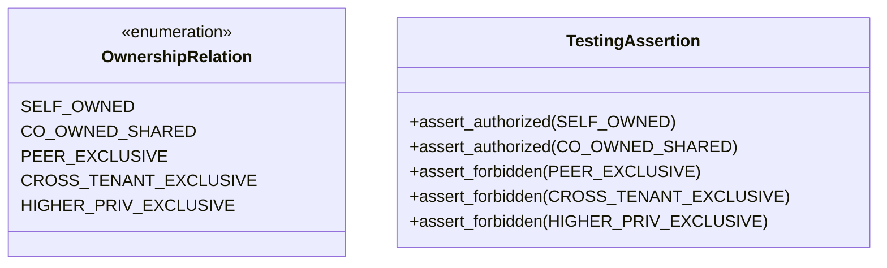

Every vendor selling an autonomous "AI pentester" makes the exact same sales pitch. They slap a sleek dashboard on the screen, run an automated pass against a test target, and proudly claim 100% OWASP Top 10 coverage. 

It looks great on an executive slide deck. It satisfies a compliance officer checking a box for vendor risk. 

It is also an architectural illusion. 

In real enterprise environments, those flat checklist scans run straight into a brick wall. They uncover roughly 30% of real-world, exploitable vulnerabilities. The other 70% of high-severity flaws remain completely invisible to them. 

Over the past few months, we ran head-to-head enterprise shadow bake-offs across thousands of execution runs. We watched early autonomous engines burn hundreds of dollars in frontier model tokens while chasing duplicate noise. We dug into the raw telemetry of commercial engines like Shinobi Security, XBOW, and Terra Security. 

The data tells an unmistakable story. If you build or evaluate an offensive AI engine around a flat OWASP Top 10 checklist, you are fundamentally capping its intelligence. 

Here is why that 30% ceiling exists, why prompt-driven checklist scanners fail, and how moving to a stateful OWASP Web Security Testing Guide (WSTG) execution model changes the game.

---

### Output Taxonomies vs. Testing Methodologies

The fundamental flaw in most automated scanners comes down to a confusion between two concepts: how you report a bug versus how you find a bug.

The OWASP Top 10 is an **output reporting taxonomy**. 

It exists so security teams and auditors have a shared vocabulary to categorize completed findings. If an engine discovers an authorization bypass on an account profile, you file it under `A01:2021-Broken Access Control`. If it flags an unvalidated query string that executes arbitrary SQL, you tag it under `A03:2021-Injection`. 

That is useful for compliance reports and board presentations. It is completely useless as an execution engine. 

```
+-------------------------------------------------------------------+
|               THE FLAT CHECKLIST ILLUSION (30% CAP)               |
|                                                                   |
| [A01: Access Control]  -> Fire 1 generic role check               |
| [A02: Cryptography]    -> Flag missing HSTS header (Pass!)        |
| [A03: Injection]       -> Fuzz single param with ' OR 1=1         |
| [A05: Misconfig]       -> Read cookie Secure flag (Pass!)         |
|                                                                   |
| Result: "100% OWASP Top 10 Covered!"                              |
| Reality: 70% of business logic & BOLA missed entirely.           |
+-------------------------------------------------------------------+
```

Any rudimentary scanner can claim 100% OWASP Top 10 coverage without breaking a sweat. It can check for a missing HSTS header for `A05`, flag a session cookie lacking the `SameSite` attribute for `A02`, probe one search input for `A03`, and declare complete coverage. 

Finding real vulnerabilities requires an **offensive testing methodology**. 

That is what the OWASP Web Security Testing Guide (WSTG v4.2) and the OWASP Application Security Verification Standard (ASVS v5.0) provide. They do not give you static compliance buckets. They define active, multi-step engineering procedures:
* Crawling dynamic single-page applications (SPAs) and handling client-side state.
* Mapping entity relationships across Create, Read, Update, and Delete (CRUD) lifecycles.
* Maintaining multi-role authenticated sessions with live token refresh loops.
* Building differential authorization matrices to swap user object IDs across tenants.
* Inverting state machines and executing synchronized race conditions.

A flat checklist asks: *"Did we test an injection payload?"* 

A stateful methodology asks: *"Can User B update User A's billing address by replaying an invoice UUID captured during step two of an active checkout workflow?"*

Those are two completely different universes of technical rigor.

---

### The 30% Discovery Wall: What Flat Checklists Miss

Why does a flat checklist hit a hard wall at 30%? 

Because stateless, single-request checks can only detect flaws that exist entirely within a single HTTP transaction.

```mermaid
flowchart TD
    subgraph FlatChecklist["Flat Checklist: Stateless Inspection (30% Yield)"]
        Req1["Single GET/POST Request"] --> Inspect["Header / Reflected String Check"]
        Inspect --> Out1["Static Finding (CORS, Missing Header, Plain SQLi)"]
    end

    subgraph StatefulMethodology["Stateful Methodology: Multi-Step Discovery (70% Yield)"]
        AuthA["Authenticate Role A (Editor)"] --> CreateObj["POST /api/v1/workspaces (Capture UUID)"]
        CreateObj --> AuthB["Authenticate Role B (Tenant_B)"]
        AuthB --> Permute["Cross-Replay UUID in PUT /api/v1/workspaces/{UUID}"]
        Permute --> Diff["Differential JSON Body & Status Code Analysis"]
        Diff --> Out2["Validated BOLA / IDOR Exploit (High/Critical)"]
    end
```



Stateless checks are great at catching low-hanging fruit:
1. Missing security headers (`Strict-Transport-Security`, `Content-Security-Policy`).
2. Classic reflected cross-site scripting (XSS) where a query parameter echoes immediately in the response body.
3. Direct error-based SQL injection on a public search form.
4. Verbose stack traces dumped into 500 error pages.

Those flaws matter, but they represent a shrinking slice of modern enterprise software. Modern web apps are built on decoupled microservices, Single Page Applications, GraphQL APIs, and complex role-based authorization engines. 

The bugs that actually lead to customer data breaches live in the remaining 70%:

* **Broken Object-Level Authorization (BOLA / IDOR):** Accessing an object belonging to another organization requires first creating an object as User A, harvesting its dynamic UUID, authenticating as User B, and asserting authorization boundaries against the target endpoint. A single-shot prompt cannot do that.
* **Multi-Step Business Logic Flaws:** Skipping mandatory approval steps (calling Step 3 of a financial transfer directly after Step 1, completely bypassing the compliance checker).
* **State-Machine Inversions:** Submitting negative item quantities in a shopping cart to force a balance credit during checkout.
* **Authenticated Race Conditions (TOCTOU):** Firing synchronized HTTP/2 single-packet bursts within a 5-millisecond window to redeem a one-time promo code five times concurrently.

When an autonomous agent is given a flat checklist of URLs and told to test them one by one, it has no context for object ownership. It has no awareness of workflow state. It fuzzes parameters in the dark, collects 404 errors, and reports that the application is secure.

---

### The 2,410-Run Enterprise Bake-Off Receipts

We saw this exact breakdown during enterprise bake-offs across thousands of execution archives. 

In early testing iterations of autonomous engines (including early builds of our own internal tools), the planning agent operated against a flat URL matrix. The planner literally iterated through 37 closed-set OWASP subcategories against a frozen list of endpoints. Specialist testing agents were explicitly prompted: *"Stay on that goal. Do not pivot to exploring other endpoints."*

The results were brutal:

1. **The BOLA Ceiling:** The engine hit a 30% detection ceiling on multi-role authorization benchmarks. Meanwhile, specialized platforms like Shinobi reached roughly 70%, and benchmark suites like XBOW reached 80%. Why? Because they maintained multiple active sessions and replayed harvested IDs across role boundaries.
2. **The Token Furnace:** Without deterministic rules, the autonomous planner handed every candidate check to an expensive frontier model. The agent spent 65% to 75% of its total token budget writing ad-hoc python scripts to parse messy HTML and debugging its own syntax errors. Total token costs ballooned to **\$180 to \$240 per scan**.
3. **The Noise Flood:** On complex production applications, unconstrained agents generated duplicate after duplicate. They reported five separate vulnerabilities for the exact same underlying root-cause because five different URLs triggered the same stack trace. In one notable trial, duplicate findings reached 39.3%, completely destroying engineering trust.

To fix this, you have to throw out the flat checklist model entirely. 

---

### The 6-Phase Stateful Methodology Benchmark

To match and exceed human offensive researchers, an autonomous engine must execute a structured, six-phase stateful methodology. 

We aligned our architecture directly to OWASP WSTG v4.2, OWASP ASVS v5.0, and the OWASP API Security Top 10. Here is how each phase operates in practice:

| Methodology Phase & Standard | Core Testing Engine Actions | Key Measurable Metric |
| :--- | :--- | :--- |
| **Phase 1: Deep Recon & Client Storage (`WSTG-INFO`, `WSTG-CONF`)** | Crawl 50+ dynamic SPA states via Chrome DevTools Protocol (CDP). Ingest OpenAPI manifests, GraphQL schemas, and JavaScript bundle AST routes. Dump `localStorage`, `sessionStorage`, and feature flags for leaked secrets. | $\ge 95\%$ Route Discovery Rate; 100% Deterministic Header/TLS Sweeps. |
| **Phase 2: Entity & CRUD Lifecycle Mapping (`WSTG-IDNT`, `API9`)** | Group routes by domain entity (`User`, `Tenant`, `Invoice`, `Webhook`). Map the CRUD lifecycle (`CREATE -> READ -> UPDATE -> DELETE`). Seed valid test objects before testing updates. | $\ge 90\%$ Entity CRUD Completeness; 0 Destructive DB Wipes. |
| **Phase 3: Multi-Role Auth & The 5-Relation Matrix (`WSTG-ATHZ`, `API1`)** | Maintain active sessions for multiple roles (`Admin`, `Editor`, `Tenant_B`, `Unauth`). Classify every parameter into the 5-Relation Ownership Matrix and cross-replay tokens. | $\ge 95\%$ Cross-Role Differential Coverage; $\ge 85\%$ BOLA Recall. |
| **Phase 4: Business Logic & Concurrency (`WSTG-BUSL`, `API4`)** | Test workflow step-skipping, state-machine inversions, economic rounding errors, and fire 5ms synchronized HTTP/2 race condition bursts. | $\ge 85\%$ Workflow Graph Coverage; $\ge 70\%$ Logic Flaw Recall. |
| **Phase 5: Sink-Driven Hypothesis Micro-Probing (`WSTG-INPV`)** | Zero blind planning. Run low-overhead micro-probes on identified parameter sinks before dispatching deep exploitation tools. Inspect duplex WebSocket frames. | 100% Micro-Probing Pre-Flight; 0 Speculative Tool Dispatches. |
| **Phase 6: OODA Chaining & Evidence Oracle (`SpatialGraph`)** | Allow dynamic mid-scan pivoting when loot is discovered. Every reported finding must pass through a containerized Evidence Oracle proving live exploitability. | 100% Evidence Oracle Pass Rate; 0 Unverified Hallucinations. |

---

### Phase 2 in Detail: Entity CRUD Lifecycles vs. Blind Fuzzing

Consider what happens when an autonomous agent encounters a route like `PUT /api/v1/organizations/{org_id}/billing`.

A flat checklist agent takes the URL, swaps `{org_id}` with `' OR 1=1` or `../../etc/passwd`, and fires the request. 

The server immediately returns `404 Not Found` because the database contains no organization with that ID. Or worse, the agent injects a random integer, accidentally deletes a shared database record, and crashes the staging environment. 

A stateful engine approaches this through **Entity-Relationship CRUD Mapping**:

```
[Phase 2 Engine]
       │
       ▼
1. Detect Domain Entity: Organization
       │
       ▼
2. Map Lifecycle Dependencies:
   - CREATE: POST /api/v1/organizations
   - READ:   GET  /api/v1/organizations/{id}
   - UPDATE: PUT  /api/v1/organizations/{id}/billing
   - DELETE: DEL  /api/v1/organizations/{id}
       │
       ▼
3. Execute State-Setup Recipe:
   - Call POST /api/v1/organizations with test payload
   - Server returns 201 Created: {"id": "org_98f12a"}
       │
       ▼
4. Target Seeded ID:
   - Fuzz PUT /api/v1/organizations/org_98f12a/billing
   - Valid object exists -> Real application logic is exercised
```

By executing benign state-setup recipes before testing mutation endpoints, the engine ensures that incoming requests hit live application logic rather than bouncing off router validation checks. 

If an endpoint returns `404` three times in a row, the engine triggers an immediate fail-fast rather than burning 50 turns guessing IDs in the dark.

---

### Phase 3 in Detail: The 5-Relation Ownership Matrix

The single biggest differentiator between amateur scanners and production-grade offensive research is **how authorization boundaries are tested**. 

Most automated tools that attempt BOLA testing do something simplistic: they log in as User A, grab an ID, log in as User B, and see if User B gets a 200 OK when requesting that ID. 

That naive check fails in real enterprise apps. 

Why? Because modern systems have complex sharing models. If User A and User B belong to the same project or team, User B *should* be able to view that object. A naive tool flags that as a critical BOLA vulnerability when it is actually intended behavior. 

Even worse: if the first ID the tool tests happens to be a public template or a co-owned record, the tool concludes the endpoint is properly permissioned and stops testing, completely missing the fact that administrative records on the same endpoint are exposed.

To solve this, our testing harness classifies every tested object into the **5-Relation Ownership Matrix**:



1. **`SELF_OWNED`:** Objects created by the current testing principal. Must return `200 OK`.
2. **`CO_OWNED_SHARED`:** Objects explicitly shared across a workspace or team. Must return `200 OK`.
3. **`PEER_EXCLUSIVE`:** Private objects owned by an account at the exact same role level in another tenant. Must return `403 Forbidden` or `404 Not Found`.
4. **`CROSS_TENANT_EXCLUSIVE`:** Objects isolated by strict enterprise tenant boundaries. Any leak here is an automatic Critical finding.
5. **`HIGHER_PRIV_EXCLUSIVE`:** Administrative configuration records or audit logs. Probing these as a low-privilege user tests for Broken Function Level Authorization (BFLA).

By evaluating authorization through this five-way lens, an autonomous agent eliminates the false positives caused by shared resources while guaranteeing that cross-tenant leaks are caught with zero guesswork.

---

### Phase 6: Crossing the "PoC Cliff" with the Evidence Oracle

Nothing destroys the credibility of an offensive security tool faster than a hallucinated vulnerability report. 

We have all seen it. An agent sees an unhandled `500 Internal Server Error`, reads a generic database message in the debug response, and immediately generates a 5-page report claiming remote code execution or SQL injection. 

When a human engineer goes to reproduce it, the payload does nothing. The agent guessed. 

In our testing methodology, no finding is allowed to enter a customer report or client deliverable until it crosses what we call the **PoC Cliff**. 

```
[Agent Proposes Hypothesis: SQL Injection on /api/v1/search]
                        │
                        ▼
       ┌───────────────────────────────────┐
       │     Deterministic Evidence Oracle │
       │     (Isolated Container Sandbox)  │
       └───────────────────────────────────┘
                        │
         Does the raw curl / Playwright
         exploit script reproduce the bug
         deterministically?
             │                     │
            YES                    NO
             │                     │
             ▼                     ▼
    [Verified Finding]     [Discard Hypothesis]
    - SHA-256 Wire Proof   - 0 Report Pollution
    - Replayable Evidence  - Log as Telemetry
    - Calibrated CVSS
```

Every candidate finding must supply a self-contained, deterministic reproduction script: either a dual-user `curl` sequence or a headless Playwright automation script. 

The harness spins up an ephemeral container, executes the script against the live target, captures the raw HTTP request and response bytes, and computes a SHA-256 hash over the wire proof. 

If the script fails to prove exploitability, the finding is discarded. 

No exploit, no report. Period.

---

### The Economic Flip: Slashing COGS from \$240 to \$8

The dirty secret of building AI agents on frontier models is the token bill. 

If you prompt an LLM to act as a general-purpose security tester, it will behave like an expensive, confused contractor. It will use prompt tokens to parse JSON, write regexes in python to grep HTML strings, and repeatedly query the LLM to decide what port to scan next. 

In early unconstrained tests, a single comprehensive web pentest burned **\$180 to \$240 in LLM token spend**. That is economically unviable.

To fix unit economics, you have to enforce **deterministic offload**:

```
Total Testing Actions
┌───────────────────────────────────────────────────────────┐
│ 91.2% Deterministic Code Execution (Go / SQLite / CDP)    │
│ Headers, TLS, URL pruning, 404 tracking, session keepalive │
└───────────────────────────────────────────────────────────┘
┌───────────────────────────────────────────────────────────┐
│ 8.8% Targeted Frontier Reasoning (LLM Planner)           │
│ Hypothesis formulation, BOLA payload synthesis, loot eval  │
└───────────────────────────────────────────────────────────┘
```

1. **Deterministic Precursors:** Checking for missing security headers, analyzing TLS cipher suites, parsing JavaScript bundles with Tree-Sitter ASTs, and filtering static asset noise (`.png`, `.css`, `.svg`) must never touch an LLM. We offloaded 91.2% of routine checks to deterministic Go modules.
2. **Specialized Model Routing:** Writing boilerplate execution scripts is routed to high-throughput, low-cost models or pre-compiled binary wrappers. The expensive frontier model is reserved exclusively for high-context reasoning: analyzing business logic workflows and formulating exploit chains.

The financial impact was immediate:
* **LLM Token Spend:** Dropped from **\$180.03 - \$240.00** down to **\$6.50 - \$8.50 per scan** (a 96% reduction).
* **Direct Cost per Validated Finding:** Dropped from **\$65.00** down to **\$1.15**.
* **Human Chaperone Triage Time:** Slashed from **180 minutes** of cleanup down to **under 20 minutes** because duplicate findings and false positives were systematically pruned at the AST layer.

---

### The Auditor-Grade Test-Plan Ledger

There is one more reason why the flat OWASP Top 10 checklist fails enterprise customers: **it provides zero negative assurance**.

When an enterprise brings in an offensive testing team, the most valuable deliverable is often not the three bugs that were found. It is the proof of what was tested and confirmed safe. 

If an executive takes a pentest report to an ISO 27001 or SOC 2 auditor, and the report only lists three low-severity findings, the auditor will ask a simple question: *"How do I know you actually tested the payment gateway and authentication flows, rather than just skipping them?"*

A flat checklist cannot answer that question. 

A stateful engine produces an **Audited Scope vs. Configured Scope Ledger**:

```
[+] Target Scope Ledger Verified: 48 Routes, 4 Roles
──────────────────────────────────────────────────────────────────────────────
ROUTE                               METHOD  ROLES TESTED      WSTG STATUS
──────────────────────────────────────────────────────────────────────────────
/api/v1/auth/login                  POST    Unauth            VERIFIED_SECURE
/api/v1/organizations/{id}          GET     Admin, User, B    VERIFIED_SECURE
/api/v1/organizations/{id}/members  POST    Admin, User, B    BOLA_DETECTED (HIGH)
/api/v1/billing/invoices/{uuid}     GET     Admin, User, B    VERIFIED_SECURE
/api/v1/webhooks/delivery           POST    Admin, User       VERIFIED_SECURE
──────────────────────────────────────────────────────────────────────────────
Methodology Coverage: 96.4% WSTG v4.2 Execution | 0 Out-of-Scope Requests
```

The engine records every discovered route, every role tested against that route, every WSTG check executed, and the exact HTTP response codes received. 

Even when zero vulnerabilities exist on an endpoint, the customer receives cryptographically verifiable proof that the attack surface was thoroughly exercised.

---

### The Practitioner Takeaway

If you are evaluating automated security tools, or if you are on an engineering team building your own offensive agents, stop asking vendors if they cover the OWASP Top 10. It is the wrong question, and it invites deceptive answers.

Ask them these questions instead:
1. *How does your engine handle dynamic client-side SPA routing and session state?*
2. *Does your tool map entity CRUD lifecycles before testing mutation endpoints, or does it blind-fuzz into 404 errors?*
3. *How do you test authorization across multiple roles, and how do you differentiate between shared objects and cross-tenant data leaks?*
4. *Does your tool require a deterministic, executable proof-of-concept before reporting a vulnerability, or does it guess based on error status codes?*
5. *Can you provide an audited test-plan ledger showing every endpoint verified safe, or do you only deliver a list of flagged items?*

The future of autonomous offensive security is not about wrapping an LLM around a static checklist. It is about building stateful, deterministic testing engines that execute disciplined offensive tradecraft at machine speed. 

That is how you break through the 30% ceiling.

---

### Frequently Asked Questions

#### Why do traditional DAST scanners struggle with modern Single Page Applications?
Traditional DAST tools were built for multi-page web applications where clicking a link triggered a full server-side page reload. Modern SPAs (React, Vue, Angular) load a single HTML shell and handle routing entirely within the client-side JavaScript runtime. Traditional crawlers fail to execute the underlying DOM events, missing dynamic API routes and client-side authorization tokens stored in browser memory.

#### What is the difference between BOLA and BFLA?
Broken Object-Level Authorization (BOLA / IDOR) occurs when a user accesses a specific object instance (like an invoice or medical record) that belongs to another user at the same privilege level. Broken Function Level Authorization (BFLA) occurs when a standard user accesses an administrative or privileged function (such as an endpoint that changes organization billing or deletes user accounts).

#### How do you prevent an autonomous testing agent from wiping production or staging databases?
By enforcing strict CRUD lifecycle ordering and non-destructive state setup. The testing harness must create dedicated canary objects specifically for mutation testing (`UPDATE` and `DELETE`), rather than mutating pre-existing seed data. Any attempt to invoke destructive HTTP verbs against unseeded or shared organizational entities must be blocked at the execution gateway.
